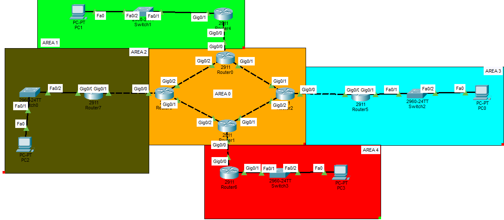

# Lab 01: Multi-Area OSPF & DHCP Configuration

## 📌 Objective
The primary goal of this lab is to design and implement a highly scalable enterprise network routing architecture. By utilizing Multi-Area OSPF, the network optimizes Link-State Database (LSDB) overhead and reduces routing update traffic. Additionally, DHCP services are integrated directly on the routing infrastructure to dynamically allocate IP configurations (IP addresses, Subnet Masks, Default Gateways, and DNS servers) to end devices.

## 📸 Network Topology

## 🛠️ Applied Technologies & Concepts
* **OSPFv2 (Open Shortest Path First):** Configured as the core Interior Gateway Protocol (IGP).
* **Multi-Area Architecture:** Segmented the network into 5 distinct areas (Area 0, 1, 2, 3, 4) to ensure hierarchical design.
* **Backbone Area (Area 0):** Acted as the core transit area interconnecting all peripheral areas to prevent routing loops.
* **Area Border Routers (ABR):** Configured specialized routers at the boundaries of Area 0 to translate and route inter-area traffic seamlessly.
* **DHCP Server Integration:** Configured edge routers with DHCP Pools, excluded address ranges, Default Gateways, and DNS server settings to fully automate host IP configurations.

## 💡 Implementation Highlights
1. **Routing Verification:** Ensured full network convergence. The routing tables successfully populated with Inter-Area routes (marked as **O IA**).
2. **Dynamic Addressing:** End devices successfully obtained dynamic IP configurations and DNS settings via DHCP DORA process without manual static assignment.
3. **End-to-End Reachability:** Validated full connectivity across the entire topology via ICMP `ping` tests between PCs residing in completely isolated OSPF areas.

---

  

